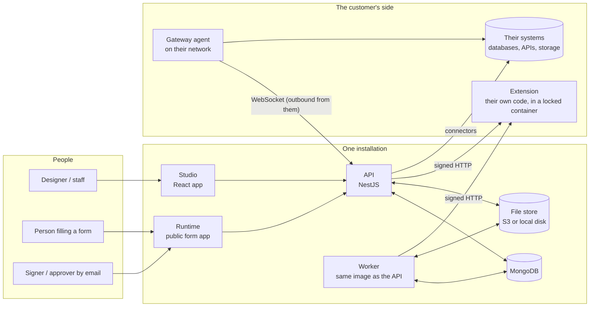
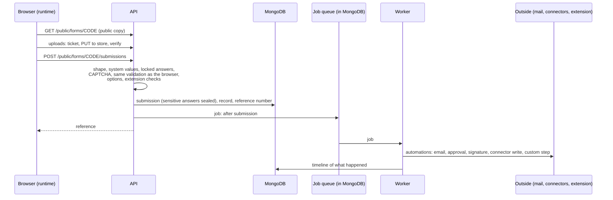
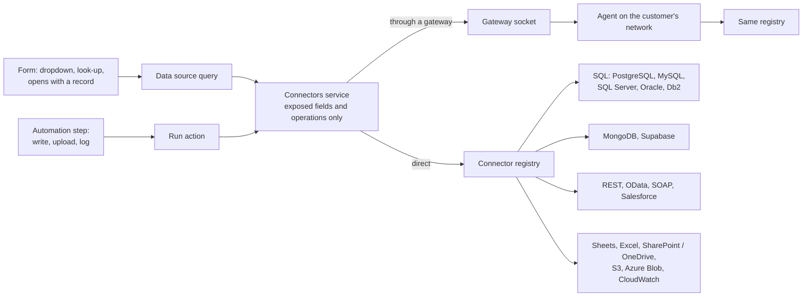
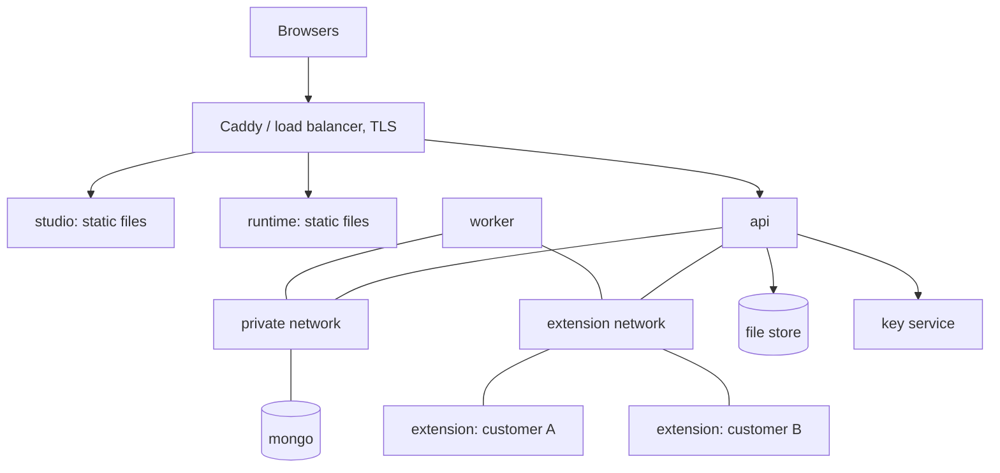

# Form Builder: architecture

_How the product is put together, as of 11 October 2026. For what each feature does, see [guide.md](guide.md); for running it, [operations.md](operations.md) and [hosting.md](hosting.md)._

## 1. The product in one paragraph

Form Builder is a hosted product for making forms and running what happens after they are filled in. A designer builds a form in the **studio**; people fill it in on the **runtime** (the public form app); the **API** checks and stores each response, turns it into a record with a status and an owner, and runs the workflow: emails, approvals, signatures, PDFs, and writes to the customer's own systems through **connectors**. Customers never receive the product's source: their own logic runs as an **extension** beside the product, and their private systems are reached through a **gateway** they install.

## 2. The pieces

| Piece | Where | What it is |
|---|---|---|
| Studio | `apps/studio` | The builder and back office: forms, workflow canvas, inbox of records, connectors, members, settings. React 18, Vite, TanStack Query, React Hook Form. Static files once built. |
| Runtime | `apps/runtime` | What the public sees: a form (`/f/<org>/<CODE>`), the requests portal (`/portal/<org>`), the signing page (`/sign/<token>`), the payment return page, and an embed script. Static files once built. |
| API | `apps/api` | Everything else. NestJS 10 on Node 20, one module, about 45 collections in MongoDB through Mongoose. |
| Worker | `apps/api` (`dist/worker.js`) | The same image as the API, started to run queued jobs instead of serving requests. |
| Gateway | `apps/gateway` | A small agent a customer runs inside their network. It dials out to the API and runs connector calls there. |
| Engine | `packages/engine` | The form definition, its validation, rules, calculations, translations and PDF rows. Shared by the browser and the server, so both check an answer identically. |
| Connectors | `packages/connectors` | One plugin per kind of outside system, behind one registry. Used by the API and by the gateway. |
| SDK | `packages/sdk` | What a customer's extension is written with: the contract, the signature check, a small server. |
| Extension starter | `examples/extension-starter` | The repository a customer's extension begins from. |

The repository is a pnpm workspace. `packages/engine` and `packages/connectors` are built first; the API and gateway load their build output.

## 3. The form definition is the centre

Almost everything is driven by one JSON document, the **form definition** (`packages/engine/src/types`). It holds:

- **fields** (questions, sections, repeating sections, tabs, steps), each with its validation, options, data source and translations;
- **rules** (show, require, calculate) and **events** (on open, on a button, when an answer changes: fill, look up, move, save, send);
- **workflow** (statuses, the buttons that move a record, approvals, time limits, escalation, work fields);
- **automations** (a trigger and a list of steps: email, notify, approval, signature, assign, status, webhook, custom step, go back);
- **document** (the PDF: title, what to leave out, archival, sealed, the organisation's own PDF);
- **openWith** (the form opens filled from a record the server reads);
- access, opening and closing times, payment, languages, look.

A definition is validated by one Zod schema (`definition.schema.ts`) when it is saved and again, more strictly, when it is published. Versions are kept: a published version never changes; editing makes a new draft above it, and a record is always shown and re-rendered against the version it was submitted to.

What the public page receives is a **public copy** (`public-copy.ts`): the definition with everything that only the server acts on removed (workflow, automations, who is emailed, which systems are called, where opening answers come from).

## 4. What happens to a response

The checks on the server are the browser's own, run again (`buildZodSchema` in the engine), plus the ones only a server can make: values the system supplies, answers locked to the signed-in person or to a record, options that come from a data source, the row count of a section that follows an answer, a human check, and the customer's own "submit checks" in their extension. A response is idempotent by key: a double click returns the first result.

Automations run from a durable queue, so a restart loses nothing: a job that is retried finds what its earlier attempt already did, step by step, on the record's timeline, and carries on from there. A flow that pauses (an approval, a signature) is stored as a **flow run** and resumed by the decision.

## 5. Inside the API

One NestJS module, organised by folder:

| Area | Folder | Notes |
|---|---|---|
| Sign-in and sessions | `auth`, `sso` | Passwords, TOTP second factor, short-lived access tokens with a refresh cookie, sessions that can be revoked, SAML and OpenID sign-in per organisation, idle sign-out. |
| Organisations and people | `orgs`, `access` | Every row carries an `orgId`. Roles: owner, admin, designer, publisher, records worker, viewer, connector user and manager. A role can be granted on a folder or a single form as well as on the organisation. |
| Forms | `forms` | Folders, versions, drafts, review and comments, scheduled publishing, import and export. |
| Responses and records | `work` | Submissions, records, the inbox, assignment, approvals, time limits and escalation, bulk actions, staff files, sharing, away cover. The automation runner is `form-automation.service.ts`. |
| Public endpoints | `work/controllers/form-public.controller.ts`, `portal`, `drafts`, `signatures`, `payments`, `verify` | No session needed; every route is rate limited and reads only what a published form binds. |
| Documents | `documents` | The PDF of a response (`submission-pdf.ts`, PDFKit), the organisation's own PDF filled in (`own-pdf.ts`, pdf-lib), batches, archival output (PDF/A-2b), and sealing with a certificate (`pdf-seal.ts`, `seal.service.ts`). |
| Signatures | `signatures` | Signers get a private link, optionally confirm by an emailed code or something they know, sign, and the signed copy gets a page of signatures. |
| Connectors | `connectors`, `gateways` | Credentials, exposed tables and fields, the calls a form may make, related rows, sign-in as a person. |
| Extensions | `extensions` | Installing a customer's extension, calling it, and the pipeline that builds and delivers it from their repository. |
| Jobs | `jobs` | The queue: a collection in MongoDB, leased by workers, with retries and de-duplication. |
| Plans and usage | `plans`, `operator` | What each plan includes, monthly usage, operator commands. |
| Logs and audit | `logs`, `audit` | An organisation's own log of what its workflows and connectors did; an audit trail of who changed what. |
| Mail | `mail` | The product's own mail, or the organisation's own server (SMTP or Microsoft 365). |
| Storage and keys | `common` | An object store (S3, or a local folder), a key provider (KMS, or a local key), a virus scanner (ClamAV, optional). |

### Tenancy

One installation serves many organisations. Separation is by `orgId` on every document and every query; there is no shared row. An organisation that needs more than that is given an installation of its own (see hosting).

### Secrets

- Connector credentials, sealing certificates and mail passwords are stored with **envelope encryption**: each is sealed with its own data key, and that key is wrapped by KMS (or a local master key in development). The API never returns them.
- Answers marked **Sensitive** are sealed in the database, field by field, by a Mongoose plugin (`sealed-answers.ts`).
- Links that grant something (a signing link, a saved draft, a form opened with a record, an approval from email, a connector sign-in) are either random tokens stored only as a hash, or signed with the installation's key so they cannot be guessed, altered or reused elsewhere.

## 6. Reaching the customer's systems

- A connector exposes nothing until a connector manager ticks a table, its fields and what forms may do with it (list, get, look up, insert, update, upload, log). Reads return only exposed fields, whatever the other system sends.
- SQL is built by one statement builder for five dialects: names are checked against the exposed list and quoted, values are always parameters.
- Web connectors go through one fetch that refuses private addresses and plain http outside development.
- A table can name **related rows** in another table (even on another system); a look-up that finds a few rows brings them along.
- A REST or OData connector can sign in as an application or as a person (OAuth); tokens are kept only for their real life and replaced when a system answers 401.
- A **gateway** is for systems that are not on the internet: the agent connects out to the API over a WebSocket and runs the same connector code next to the database. Db2 always goes this way on our hosted servers, because IBM's driver does not exist for ARM Linux.

## 7. The customer's own code: extensions

A customer's logic (a step in a workflow, a list for a dropdown, a check before a response is accepted) lives in their own repository, written with the SDK. The product calls it over HTTP with a signed request and a versioned contract; it never runs inside the product's process.

Each extension is a container of its own, started locked down: not root, read-only disk, small memory and CPU, no published port, no route to the database or to another customer's container, and no route to the internet unless outbound addresses have been agreed, in which case it gets a proxy that allows only those (`infra/egress`). The delivery pipeline (`extension-repo`, `extension-deploy`) builds the image from their repository and deploys it.

## 8. How it is hosted

One installation is the same five containers everywhere (`infra/docker/compose.yml`): **mongo**, **api**, **worker**, **studio**, **runtime**, plus one container per customer extension.

- **Shared**: one installation for many organisations. **Dedicated**: an installation for one customer. Same images, same commands (`pnpm stack ...`), and a customer can move from one to the other.
- **The pilot** (`infra/pilot`): one ARM server in AWS Mumbai running that compose file behind Caddy (TLS), with images in ECR, files in S3, and releases by `infra/pilot/release.sh`.
- **The planned production shape** (`infra/terraform`, validated, never applied): API and worker on ECS Fargate behind a load balancer, the two web apps on S3 and CloudFront, MongoDB Atlas, S3 for uploads, KMS, one fixed outbound address for customers to allow, and a locked service per extension.

## 9. How it is tested

| Layer | What | Where |
|---|---|---|
| Engine | Validation, rules, calculations, imports, translations | `packages/engine/test` (Vitest) |
| Connectors | Each plugin, the statement builder, WSDL reading, token renewal | `packages/connectors/test` (Vitest) |
| API | The real application on an in-memory MongoDB, over HTTP | `apps/api/test` (Jest, about 500 tests) |
| Studio and runtime | Components and screens | Vitest with Testing Library |
| Whole product | API, studio, runtime and gateway in a real browser | `e2e` (Playwright, 115 tests) |

Beside those, the things that must work with something that is not ours are checked against the real thing in CI: PostgreSQL, MySQL, SQL Server and Oracle (job `databases`), Db2 with IBM's driver (job `db2`), a SOAP server run by an independent library, Keycloak for signing a connector in as a person, veraPDF for archival PDFs, and poppler's `pdfsig` for sealed ones. CI also runs a dependency audit, a secrets scan and the image builds.

## 10. Choices worth knowing

- **One definition, checked the same way twice.** The engine runs in the browser and on the server, so a rule cannot hold in one and not the other.
- **Published versions do not change.** A record always belongs to the version it was submitted to.
- **The queue is the database.** Jobs are a MongoDB collection, not a separate broker: one fewer thing to run, and a job and the data it changes commit to the same place.
- **No customer code in our process.** Extensions are separate containers behind a signed contract; connectors are configuration, not code.
- **Nothing is exposed by default.** A connector exposes no table, a form's public copy carries no workflow, and a public page can query only the sources its published form binds.
- **Authoring stays in plain words.** Settings are dropdowns and switches with auto-matching by name; there are no expression editors for the common cases and no AI features.
